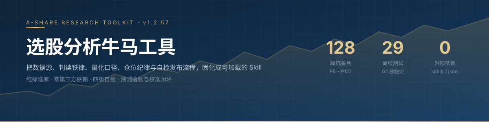
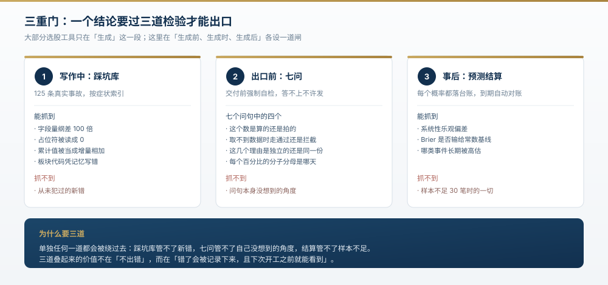
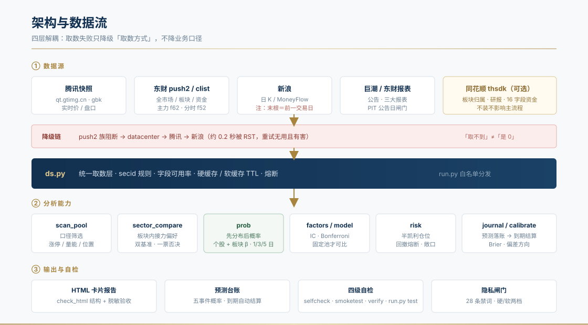

# 选股分析牛马工具



一个 **A 股个人研究复盘工具**。把数据源、判读铁律、量化口径、仓位纪律，
以及最关键的——**一套会自我否证的检查机制**——固化成可被 Agent 加载的 Skill。

**130 条踩坑 · 29 个离线测试 · 44 个脚本 · 0 个第三方依赖 · MIT**

---

### 这个工具最重要的功能，是记录它自己错在哪

> 它**不会**告诉你明天买什么。
>
> 它会告诉你：**你这个判断有多大概率是错的，以及错的时候你会在哪一步先发现。**

---

## 为什么会有这个项目

做 A 股个人研究，最不缺的是数据，最缺的是**不被自己骗的机制**。

真实的痛点是这些，不是「没有选股公式」：

| 你会遇到的事 | 常见工具的处理 | 这里怎么处理 |
|---|---|---|
| 接口字段单位差 100 倍，算出「某银行 0.09 元」 | 不报错，一路算到底 | 强制先 dump 原始记录确认量纲（**P116**） |
| 盘中资金流是**当日累计值**，却当成每分钟增量相加 | 图表照画 | 文档级硬警告 + 恒等关系断言（**P93**） |
| 板块代码凭记忆写，`BK0475` 其实是银行不是电力设备 | 数字自洽，看不出来 | `board_check()` 反查名称，不符**抛异常而非返回空**（**P108**） |
| 给了一堆概率，但彼此矛盾（站上更高门槛的概率反而更大） | 分别估、并列展示 | 先构造分布，所有概率**从同一分布读出**，单调性违反直接抛错（**P109**） |
| 预测做完了，从不回头看准不准 | 无 | 每个概率落台账，到期自动结算，算出系统性偏差 |
| 模型 AUC 只有 0.51，还继续用它选股 | 继续用 | **明确禁用**，写进文档并标注「未通过检验」 |

每一条后面那个编号，都是 `references/pitfalls.md` 里的真实事故记录——**不是虚构的最佳实践，是踩过的坑**。

---

## 它和常见选股工具的区别

| 维度 | 常见工具 | 本工具 |
|---|---|---|
| **输出** | 买入信号 / 目标价 | 候选池 + **情景概率树** + 可证伪条件 |
| **确定性** | 斩钉截铁 | **「不交易」是合法结论**（凯利 f\* ≤ 0 就不下注） |
| **错误处理** | 尽量显得没问题 | 把错误本身做成资产（130 条踩坑库） |
| **概率来源** | 模型输出 | **历史条件频率 + 台账校准**；模型未通过检验就不用 |
| **仓位** | 满仓 / 固定比例 | **凯利公式 + 2~3 只分散**，单笔 ≤33% |
| **验证** | 回测截图 | 外部真值比对（md5 / 远端 clone / 独立双源） |

---

## 三重门：结论怎么才敢出口



单独任何一道都会被绕过去：

- **踩坑库**管不了从没犯过的新错；
- **出口七问**管不了自己没想到的角度；
- **预测结算**管不了样本不足 30 笔时的一切。

三道叠起来的价值不在「不出错」，而在**「错了会被记录下来，且下次开工之前就能看到」**。

---

## 它是什么 / 不是什么

**是：**

- 一套**可复用的研究流程**：取数 → 筛选 → 判读 → 概率 → 风控 → 台账 → 校准
- 一个**判读手册**：`references/` 下 8 份文档可以脱离代码单独读
- 一个**自我检查框架**：29 个离线测试 + 4 类结构验收 + 隐私闸门
- 一个**训练材料**：想学 A 股判读方法，从踩坑库读起比读教程有效
- 一套**基本面工具**：估值分位 / 杜邦分解 / 三表勾稽 / 三维度荐股（规则透明，不是模型）

**不是：**

- ❌ 不是荐股工具——给的是概率与情景，不是买入信号
- ❌ 不是实盘接单系统——研究工具，不含下单与账户对接
- ❌ 不是估值择时工具——估值分位说的是「相对自己历史的贵贱」，**不是买点**
- ❌ 不是高频 / Level-2 工具——只用公开免费接口

---

## 架构与数据流



> 四层解耦的核心约定：**取数失败只降级「取数方式」，不降级业务口径。**
> 任一层源不可用时，下游拿到的是「不可用」而不是 `0`——避免把故障读成行情。

---

## 30 秒上手

```bash
# ① 获取（二选一，见下方表格）
git clone https://github.com/Y5H1ggs/niuma-stock-screener.git

# ② 配个人参数（外置，脚本零硬编码）
cp config.example.json config.json     # 填资金 / 权限 / 费率 / 止损

# ③ 三连自检（装完先跑这个）
python scripts/run.py doctor           # 环境体检
python scripts/run.py test             # 29 个离线单测（约 0.1 秒）
python scripts/run.py health --quick   # 接口连通性
```

**跑通标志**：`doctor` 显示「核心文件 齐全」，`test` 显示 `Ran 29 tests ... OK`。

### 两种获取方式

| 方式 | 入口 | 适用 |
|---|---|---|
| 克隆仓库 | `git clone https://github.com/Y5H1ggs/niuma-stock-screener.git` | 要全部源码、测试与开发脚本 |
| **下载云端包** | [`niuma-cloud-v1.2.57.zip`](https://github.com/Y5H1ggs/niuma-stock-screener/releases/download/v1.2.57/niuma-cloud-v1.2.57.zip)（0.45 MB / 58 条目） | 直接上架 Skill。含 `scripts` + `references` + `tests` + `README_CLOUD.md`，**不含**个人参数与交易台账 |

---

## 使用指南

下面六个场景覆盖 90% 的实际用法。命令可直接复制，`<代码>` 换成你自己的。

### 场景 1 · 今天该不该买

先判断环境，再挑票。**顺序不能反。**

```bash
python scripts/run.py review --fetch      # 拉全市场 + 指数 + 板块，落盘
python scripts/run.py review --analyze    # 涨跌分档、分位数、板块资金
python scripts/run.py mood                # 情绪温度
```

看三个数：**涨跌家数比、涨停梯队、板块资金净额**。
环境差的时候，正确答案是「不交易」——这是**合法结论**，不是失败。

### 场景 2 · 单票三维度推演

```bash
python scripts/run.py selfcheck 600000      # 17 项内部恒等断言，先确认数据可靠
python scripts/run.py sector 600000         # 板块内资金接力偏好横向对比
python scripts/run.py report 600000 --anon  # 出卡片式 HTML（--anon 脱敏）
```

`report.py` 产出：抬头指标格 + 四维评级 + 逐条加减分理由 + 5 张 SVG 图。
加 `--pdf` 用本机 Chrome 导出 PDF。

### 场景 3 · 概率预测（用它代替「猜」）

```bash
python scripts/run.py prob <代码> \
  --cond "chg<=-2.5 and vr<=1.3" \
  --cond "bk_chg<=-3" --beta BK1030 \
  --base 10.00 --levels 10.50,10.20,10.00,9.96 --horizon 3 \
  --cost 17 --record
```

输出六块：分布描述（含**二项标准误与 95%CI**）· 1/3/5 日并列 · 阈值概率（单调性断言）·
收益分档 · **决策树分叉点** · 扣费后净期望。

> `--record` 会写入预测台账，到期由 `calibrate.py` 自动结算。
> **不落账的预测等于没有预测**——因为永远不会有人回头检查它。

### 场景 3.5 · 估值贵不贵 + 财报靠不靠得住

```bash
python scripts/run.py valuation 600000          # 估值分位 / 相对行业 / PEG
python scripts/run.py valuation 600000 --dcf     # 加 DCF 敏感性表 + 反向 DCF
python scripts/run.py fundamentals 600000        # 杜邦 / 三表勾稽 / 偿债 / 成长
```

**看什么**：

| 指标 | 含义 | 危险信号 |
|---|---|---|
| PE 历史分位 | 相对**自己**过去 3 年的位置 | 分位 >85% 且增速在下滑 |
| PE vs 行业中位 | 相对**同行**的溢价 | 溢价 >1.5x 但 ROE 低于中位 |
| 杜邦分解 | ROE 是靠利润率、周转，还是加杠杆 | 权益乘数 >5 且还在上升 |
| 正应计占比 | 利润有没有变成现金 | >10% 说明利润与现金流背离 |
| 现金含量 | OCF / 净利润 | 连续 4 期 <0.8 |

> ⚠️ 两个必须知道的口径陷阱：
> **① 财报是累计口径**，Q3 直接算周转会偏低 25%（已年化处理）；
> **② 金融业不适用**这些工商企业指标（银行负债率 90% 是常态）。

### 场景 3.6 · 三维度荐股（规则筛选，不是模型）

```bash
python scripts/run.py recommend --mode value --limit 10     # 低估值
python scripts/run.py recommend --mode quality --limit 10   # 高质量
python scripts/run.py recommend --mode growth --limit 10    # 高成长
python scripts/run.py recommend --mode value --codes 600000,600519   # 指定票对比
```

三种模式的维度（**等权**，写在代码 `MODES` 字典里）：

| 模式 | 维度 |
|---|---|
| `value` | PE 分位（低好）· PB 分位（低好）· ROE · 负债率（低好） |
| `quality` | ROE · 现金含量 · 利息保障 · 负债率（低好） |
| `growth` | 营收增速 · 净利增速 · 现金含量 · ROE |

**三条必须读的话**：

1. `composite` 是**池内相对排名分**（0~100），**不是收益率、不是上涨概率**；
2. 权重等权是**约定**，未做参数优化——它只是让排序可复现，不代表找到了最优组合；
3. **红旗 ≥2 条自动降入观察池**。红旗比亮点更值得看。

### 场景 4 · 复盘自己的交易

```bash
python scripts/run.py journal add --code 600000 --price 10.00 --shares 300
python scripts/run.py journal close --id <trade_id> --price 10.50 --reason take_profit
python scripts/run.py risk status           # 当前回撤 / 熔断状态 / 仓位参数
python scripts/run.py calibrate             # 胜率归因 + 预测 Brier 校准
```

> **样本 <30 笔不许调参。** 这条是硬的——小样本调参就是过拟合自己。

### 场景 5 · 因子研究

```bash
python scripts/run.py factors --pool 500    # 单因子 IC / 分层
python scripts/run.py factor_ic             # 相关性矩阵（先查共线性再加因子）
python scripts/run.py model --validate      # 模型检验（大概率不通过，那是真实的）
```

先说结论：**102 个技术因子已饱和**，42→100 特征 AUC 零提升（0.5152→0.5158）。
新因子只有**两个不同池 + 两段时间**都站得住才算成立。

### 场景 6 · 交付给别人看

```bash
python scripts/run.py checkhtml 报告.html            # 结构验收（标签/列数/脱敏）
python scripts/run.py checkhtml 报告.html --strict   # 对外档：软隐私也拦
python scripts/run.py docscheck                      # 文档声明 vs 代码真值
```

**三道发布闸门**：`check_html`（产物结构）· `check_docs`（声明 vs 真值）· `check_privacy`（敏感信息）。

---

## 命令速查

`run.py` 是统一入口，37 个子命令：

| 类别 | 子命令 |
|---|---|
| **取数** | `ds` `ths` `make_pool` |
| **筛选** | `scan` `winrate` `sector` `mood` `review` |
| **分析** | `report` `patterns` `prob` `predict` `pit` |
| **基本面** | `valuation` `fundamentals` `recommend` |
| **风控** | `risk` `journal` `calibrate` `fees` |
| **研究** | `factors` `factor_ic` `model` `backtest` |
| **诊断** | `health` `selfcheck` `smoketest` `verify` `doctor` `test` |
| **产物** | `md2html` `checkhtml` `docscheck` `makeindex` `cfg` |

每个都支持 `--help`：

```bash
python scripts/run.py prob --help
```

---

## 它怎么保证结论不骗人

这部分是核心，也是它和「又一个选股脚本」的区别。

| 层 | 工具 | **验证什么** | **不验证什么** |
|---|---|---|---|
| 数据 | `verify.py` 双源比对 | 两个独立源是否一致 | 两源同时错（罕见但存在） |
| 代码 | `selfcheck.py` 17 项断言 | 恒等关系（主力净额 == 大单 + 超大单） | 业务逻辑是否符合现实 |
| 产物 | `check_html.py` | 标签配对、列数、脱敏 | 结论对不对 |
| 文档 | `check_docs.py` | 声明的条数 / 版本 vs 正文真值 | 内容是否合理 |
| 隐私 | `check_privacy.py` | 账户口径是否外泄 | 语义推断（「某只主板票」仍可猜） |
| 概率 | `calibrate.py` | 预测 vs 实际（Brier / 偏差方向） | 样本 <30 时的一切 |

> ⚠️ **这张表最重要的信息是最后两列。**
> 前五层全是「结构绿灯」——能保证文件没坏、代码没崩、数字自洽，
> 但**一次都没验证过结论对不对**。真正能验证结论的只有三种：
> **外部真值、样本外分段检验、有人当面质疑**。

---

## 已知局限（先说清楚）

| # | 局限 | 影响 |
|---|---|---|
| 1 | **回测样本量小** | 形态回测常见 N=5~15，**N<10 不可外推** |
| 2 | **模型未通过检验** | 样本外 AUC 0.508~0.528、Brier ≥ 常数基线 → **禁止用于选股** |
| 3 | **资金流是推断值** | 按成交金额分档推断，**拆单会系统性干扰** |
| 4 | **免费接口会限流** | 有降级链，但限流期间该维度没有信息量 |
| 5 | **盘中快照会变** | 结论是取数那刻的快照，**用前必须收盘复核** |
| 6 | **幸存者偏差无解** | 退市票不在样本 → 绝对 IC 偏乐观，只能看相对排序 |
| 7 | **评级是机械打分** | 四维加总，权重与阈值是经验设定、未做参数优化 |
| 8 | **无经审计实盘业绩** | 个人研究工具，不提供业绩承诺 |

完整 14 条及对应影响见 [`docs/LIMITATIONS.md`](docs/LIMITATIONS.md)。

---

## 项目结构

```
选股分析牛马工具/
├── SKILL.md                    # Skill 主文件（Agent 加载入口）
├── README.md                   # 本文件
├── CHANGELOG.md                # 最近 6 个版本（历史归档见 CHANGELOG_archive.md）
├── config.example.json         # 个人参数模板（复制为 config.json）
├── docs/                       # 4 张架构 / 机制图
├── scripts/                    # 44 个脚本，run.py 是统一入口
│   ├── run.py                  # ★ 所有子命令从这里进
│   ├── ds.py                   # 统一取数层（多源降级 + 量纲校验）
│   ├── prob.py                 # 先分布后概率（含单调性断言）
│   ├── risk.py                 # 凯利仓位 + 账户级风控
│   ├── journal.py              # 交易台账（append-only）
│   ├── calibrate.py            # 预测结算与校准
│   ├── valuation.py            # 估值分位 / 相对估值 / DCF / 反向 DCF
│   ├── fundamentals.py         # 杜邦 / 三表勾稽 / 健康 / 成长质量
│   ├── recommend.py            # 三维度荐股（等权分位排名）
│   ├── check_privacy.py        # 隐私闸门
│   └── ...
├── references/                 # 8 份可独立阅读的文档
│   ├── pitfalls_index.md       # ★ 先看这个（125 条速查，8.6% 体积）
│   ├── pitfalls.md             # 完整踩坑库
│   ├── playbook.md             # 判读铁律
│   ├── datasources.md          # 接口与量纲对照表
│   ├── calibration.md          # 校准方法
│   ├── backtest.md             # 回测口径
│   ├── factor_research.md      # 因子研究（含负结果）
│   └── publishing.md           # 上架与发版流程
└── tests/                      # 29 个离线测试（合成数据，不联网）
```

### 读文档的正确顺序

**不要整篇读 `references/pitfalls.md`**（约 195 KB）。按这个顺序：

1. `references/pitfalls_index.md` —— 8.6% 体积的速查表，先找症状
2. 命中编号后 `grep -A 40 "^## P115" references/pitfalls.md` 只取一节
3. 需要方法时读 `playbook.md`
4. `CHANGELOG_archive.md` **默认不读**，只在追查历史决策时看

---

## 版本与更新

**当前版本 `v1.2.57`**（2026-11-13）· 许可 MIT · 完整沿革见 [`CHANGELOG.md`](CHANGELOG.md)

最近几个版本的实质变化：

| 版本 | 核心变化 |
|---|---|
| **v1.2.57** | 补三条文档校验（发布包体积/条目、沿革表首行、英文条数）+ 反向测试；新增 P131/P132 |
| v1.2.56 | 补上基本面：PE/PB 历史分位、杜邦分解、三表勾稽、三维度荐股（`valuation` / `fundamentals` / `recommend`） |
| v1.2.55 | README 从开发日志重写为项目介绍 + 使用指南；新增架构图、概率对比图等 4 张图 |
| **v1.2.54** | 脱敏从「手写清单」改为**台账自动反推**（原清单只覆盖 16%）；重写历史提交信息 |
| v1.2.53 | 修复风控回撤恒为 0（**15% 熔断从上线起从未触发**） |
| v1.2.52 | 文档审计：同一份 README 里并存三个不同的条数；K 线末根日期是运行时变量 |
| v1.2.51 | 绿灯幻觉七型 + **出口七问**（交付前强制自检） |
| v1.2.50 | 降 token：踩坑库索引化（压缩到 9%）+ CHANGELOG 归档 |

**更新方式**：`git pull` 后重跑 `run.py test` 与 `docscheck`。
云端包用户重新下载 zip 覆盖（`config.json` 与 `_journal/` 不受影响）。

---

## 适用人群

**适合你，如果：**

- 做 A 股**波段 / 修复**为主的研究复盘，需要可复用流程
- 只做主板（默认按 `config.json` 的 `allowed_prefixes` 过滤）
- 想知道**自己的判断有多大概率错**，而不是要一个「买它」
- 愿意接受「不交易」是合法结论

**不适合你，如果：**

- 想要「明天买哪只」——这里给的是概率与情景树
- 想要投行级估值建模——这里有估值分位、相对行业、DCF 敏感性表，但**不是执业级 DCF/可比公司分析**
- 需要 Level-2 / 高频——只用公开免费接口

---

## 许可与免责声明

MIT License，见 [`LICENSE`](LICENSE)。

本项目为**个人研究工具与学习材料**：

- 所有输出均为**概率表述与情景推演**，**不含任何买卖或加减仓指令**
- 不构成投资建议，不提供业绩承诺，**据此操作风险自担**
- 数据来自公开免费接口，可能存在延迟、缺失或错误
- 回测与统计结果基于历史数据，**不代表未来收益**

---

<p align="right"><sub>把每一次踩坑都写下来，是让下一轮少踩一次的唯一办法。</sub></p>
