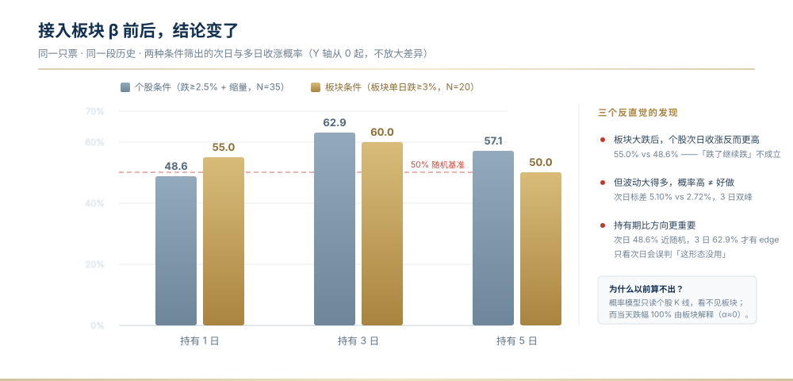

# 选股分析牛马工具


一个 **A 股个人研究复盘工具**：把数据源、判读铁律、量化口径、仓位纪律与自检/发布流程，
固化成可被任何支持 `SKILL.md` 规范的 Agent 软件加载的 Skill。

> **核心链路零依赖**：纯 Python 标准库（`urllib` / `json` / `ssl` / `re` / `math`），
> `git clone` 完直接跑。同花顺是**可选增强源**，装在独立解释器里，不装不影响主流程。

**仓库地址**：https://github.com/Y5H1ggs/niuma-stock-screener
**当前版本**：`v1.2.50`（2026-11-13）　·　许可 MIT　·　版本沿革见 [`CHANGELOG.md`](CHANGELOG.md)

**两种获取方式**

| 方式 | 命令 / 入口 | 适用 |
|---|---|---|
| 克隆仓库 | `git clone https://github.com/Y5H1ggs/niuma-stock-screener.git` | 想要全部源码、测试与开发脚本 |
| **下载云端包** | [`niuma-cloud-v1.2.50.zip`](https://github.com/Y5H1ggs/niuma-stock-screener/releases/download/v1.2.50/niuma-cloud-v1.2.50.zip)（0.39 MB / 46 条目） | 直接上架 Skill，含 `scripts` + `references` + `tests` + `README_CLOUD.md`，**不含**个人参数与交易台账 |

安装后先跑自检，再跑冒烟：

```bash
python "<包内绝对路径>/scripts/run.py" doctor    # 环境体检
python "<包内绝对路径>/scripts/run.py" test      # 29 个离线单元测试（0.1 秒）
python "<包内绝对路径>/scripts/run.py" health --quick
```

---

## 本次增强（v1.2.43 → v1.2.48）



> 为什么这张图重要：同一只票、同一段历史，**只是因为条件里加了「板块当天跌了多少」，
> 次日收涨概率就从 48.6% 变成 55.0%**。而在接入之前，模型根本看不到这个前提。


| 能力 | 说明 |
|---|---|
| **★★ 彻底移除「满仓押单只」（v1.2.48）** | 排查发现是**文档写凯利、代码算满仓**的双轨：`config.json` 的 `position_mode` 实际值仍是 `single` 且四个仓位参数全缺；`risk.py` 的仓位是 `min(cash, max_amt)`，**从未读过 `kelly_fraction` / `max_single_pct`**。已三层同时修：配置强制迁移（读到 `single` 告警并降级）+ 仓位改凯利公式 + 新增 G5 持仓数上限。**同一命令改前给「全仓」，现给「建议仓位 8.1%」** |
| **★★ 概率接入板块 β（v1.2.47）** | `prob.py` v2：`build_dist(bars, conds, beta_bars=...)` 注入 `bk_chg / bk_r1 / bk_pos60 / bk_ma_up / bk_rsi6`，**条件可直接写 `bk_chg<=-3`**。接入后结论变了：板块单日跌≥3% 时个股次日收涨 **55.0%**（个股自身条件只有 48.6%），但标差 **5.10% vs 2.72%**；且同一批样本次日 48.6%（近随机）而 **3 日 62.9%** —— **只看次日会误判「这形态没用」**（P113） |
| **★ 数据源用透：secid 规则修复（v1.2.47）** | `secid('sh000001')` 曾返回 `0.sh000001`、`secid('BK1030')` 返回 `0.BK1030`，全是错前缀 → 指数分钟线 **0 根**、板块 K 线 **0 根**，被误记为「源不支持」。修成按前缀映射后：指数分钟线 **240 根**、板块日线 **260 根**。新增 `ds.board_kline` / `ds.board_stage`（板块自身 RSI/均线/60日位置）——**这个视角此前完全缺失**（P112） |
| **★ 多周期 + 自动落账（v1.2.47）** | `r3/r5/hi3/lo3/hi5/lo5` + `--horizon 1/3/5` + `all_horizons()` 并列；`--record` 自动写预测台账（带 beta/conds 元信息）。条件引用缺失字段时**计数提示**，不静默吞 |
| **★ 单元测试（v1.2.47）** | `tests/` 29 个用例**全离线**（合成 K 线）：单调性、四格自洽、多日对齐、β 注入、条件异常计数、`<thead>` 子串坑、硬软隐私分档。`python run.py test` 一键跑。**理由**：prob 的两个核心断言都曾自己写错（单调性方向反、EV 的 N 显示成 1），这类错靠看输出发现不了 |
| **★ 概率必须「先分布、后概率」（v1.2.46）** | 新增 `prob.py`：条件样本**按日期去重合并** → 构造次日收益分布 → **所有阈值概率从同一分布读出**（单调性由构造保证，违反直接抛错）。修的是 P109 实景：曾同时给「站上 MA5 10.02」45–55% 与「跌破 MA10 9.96」50–62%，而 **10.02>9.96，站上更高门槛概率不可能更大** —— 根因是六组基准率各自独立估计、彼此无约束。配套：`decision_tree()` 找分叉点并校验「四格加权 == 边际」、`ev()` 给扣费后净期望、**决策用中位数不用均值** |
| **★ 板块代码必须反查（v1.2.46）** | `ds.board_name / resolve_board / board_check`，`fflow(is_sector=True, expect='电力设备')` 代码不符时**抛异常而非返回空**。修的是 P108：`BK0475` 被当成电力设备，实际是**银行Ⅱ**，整段资金数据全错、连续两版报告都错、且不报错、数字自洽、交叉验算发现不了 |
| **★ 报告产物验收（v1.2.46）** | 新增 `check_html.py`：`HTMLParser` 全栈标签配对 + 按标签逐个计数 + 表格列数一致 + 脱敏硬/软两档。修的是 P111：`card()` 漏 `</div>` 而 `count('<section')==count('</section>')` **照样通过**；另修 `count('<th')` 把 `<thead>` 数进去导致对正确报告误报 |
| **同花顺可选增强源** | `ds_ths.py`（纯标准库子进程桥）+ `_ths_worker.py`（只在装了 thsdk 的解释器跑）。补上一直拿不到的：**权威板块归属与成分**（根治板块代码凭记忆写错）、**券商研报**（东财恒为 0 篇）、**主动/被动资金 16 字段拆分**、**第 4 路前复权日 K**。依赖隔离、失败一律降级 `None`；与东财口径**不同源 → 只并列、禁交叉相加**（P5/P102）。自检 `python ds_ths.py check` |
| **认证结论纠正** | `thsdk.auth()` **免扫码**（临时账号）；旧结论「3.0 必须扫码」是忘了先调 `auth()` 的误判 |
| **空数据一律判失败** | `smoketest.py`：`_fl` 前必过 `_ok()`、**空候选池判硬失败**、接口层空数据纳入失败判据、**失败返回非零退出码**。盘前跑会如实报失败（预期行为，见 P105） |
| **上传前自查体系** | P102 新源「`ok:true` 但字段全空」· P103 缓存污染/北交所映射/`main()` 守卫回归/隐私闸门 · P104 空数据不算失败 · P105 盘前 0 只票被测却报通过 |
| **5 个脚本补 `main()` 守卫** | 待办 #12 结清；改写前 `tokenize` 查跨行字符串，改写后 `symtable` 查作用域断裂 + 轻量 CLI 冒烟验执行路径 |
| **发布流程** | 隐私闸门三模式（工作区 / 提交信息 / 历史）→ 暂存区结构扫描 → commit → 代理 push → `git fetch` 后等值比较 → annotated tag → Release（正文从 CHANGELOG 自动提取） |
| **★ 上架 / 云端适配（v1.2.44）** | `ds.clist_quality()` 字段可用率下沉数据层 · `THS_DISABLE=1` 可选增强源安静降级 · **`run.py` 单条绝对路径统一入口 + `doctor` 环境体检** · SKILL.md 补齐平台元信息与云端运行条件 · **`build_package.py` 生成 0.33 MB 分层包** · **`references/publishing.md` 上架方法手册** |

> ⚠️ **动态冒烟应在交易时段（09:30 后）运行**。盘前 clist 行情字段会整批返回 `'-'`，
> 此时如实报失败是设计行为；盘前只想验代码结构请用 `python smoketest.py --static`。

---

## 项目亮点

| # | 亮点 | 说明 |
|---|---|---|
| 1 | **核心链路零依赖** | 纯标准库，不装 pip 包即可跑全链路；可选增强源装在独立解释器 |
| 2 | **只给概率，不给指令** | 「禁止绝对化表述、所有情景带概率、≥50% 标高概率」是 `SKILL.md` 的硬约束；输出候选池 + 情景概率，**不下买入信号** |
| 3 | **量化胜率 + 凯利仓位** | v1.2.40 起主力入口 `winrate_select.py`：146,028 条面板实测最优形态 **52.8% vs 基准 47.0%**；半凯利 8.2%、2~3 只分散、单笔 ≤33% |
| 4 | **多源降级链 + 不静默出错** | 东财 / 腾讯 / 新浪 / 巨潮互为备份；**`_fl` 前必过 `_ok()`**，`'-'` 占位符不会被读成 0；空数据判失败并在报告打「数据完整度」警示 |
| 5 | **判读铁律固化** | 板块内资金接力偏好必查、连板梯队真实 streak 扫描、竞价三段式校准、主营构成先校验 |
| 6 | **一键出报告 + 脱敏导出** | `report.py` 产出卡片式 HTML（抬头指标格 + 四维评级 + 本期点评 + 逐条加减分理由 + 5 张 SVG 图）；`--anon` 生成不含账户口径的版本，`--pdf` 用本机 Chrome 导出 |
| 7 | **个人参数全外置** | 资金 / 权限 / 费用率 / 止损纪律 / 风控全在 `config.json`，脚本零硬编码，首次运行有录入闸门 |
| 8 | **107 条真实踩坑记录（P5~P105）** | `references/pitfalls.md`：接口字段失真、单位差 100 倍、分钟资金流是当日累计（**禁止累加**）、占位符读成 0、二值变量算分位、批量快照错位、空数据算通过…… |
| 9 | **基准不可挑选** | 行业基准 + 题材基准双轨、**取更不利者**，分歧时显式标注；板块对比前先校验主营构成 |
| 10 | **PIT 时点回测** | 用财报**实际公告日**做可见性闸门，`pit.py --demo` 量化「用最新财报回填历史」的偏差 |
| 11 | **账户级风控闸门** | 回撤熔断 / 行业敞口 / 市值档 / 风险预算；`risk.py check <代码>` 直接回答「这笔允许开吗、能开多少股」 |
| 12 | **校准闭环** | 台账 append-only + `calibrate.py`：胜率归因、漏单重建、Brier 校准。**样本 <30 笔不许调参** |
| 13 | **四层自检** | `health.py` 接口体检与结论置信度 · `selfcheck.py` 17 项内部恒等断言 · `smoketest.py` 静态 + 动态冒烟 · `verify.py` 双源比对 |
| 14 | **同花顺可选增强源** | 见「本次增强」；`ds_ths.py` 纯标准库桥，不装 thsdk 也不影响其他模块 |
| 15 | **★ 量化复盘与明日概率（v1.2.45）** | `market_review.py` 两段式：一次拉全市场 5202 只 + 四大指数 300 根 + 1026 板块落盘，之后本地反复分析。含涨跌分档/分位数、**净额≠广度**（P107）、条件基准率与分段稳定性、台账动态校准。概率为**描述性条件频率 + 方向性收缩**，非模型输出 |
| 16 | **★ 概率自洽 + 代码校验 + 产物验收（v1.2.46）** | `prob.py` 先分布后概率（单调性抛错断言）· `check_html.py` 全栈结构验收 · `ds.board_check` 三态校验（ok / unverifiable / degraded）· `ds.members_usable` 字段有值率判定 · 修 P108/P109/P110/P111 |
| 17 | **★★ β + 多周期 + 数据源用透（v1.2.47）** | `secid` 修好 → 指数分钟线/板块 K 线解锁 · `prob.py` 接入 β 与 1/3/5 日 · `--record` 自动落账 · `tests/` 29 用例离线 · 修 P112/P113 |

---

## 适用人群

**适合你，如果：**

- 做 A 股 **波段 / 修复**为主的研究复盘，需要一套可复用流程；
- **只做主板**、没有创业板/科创板权限（默认按 `config.json` 的 `allowed_prefixes` 过滤）；
- **仓位按凯利算** —— 默认 `position_mode=kelly`，按实测胜率/盈亏比定仓位，同时持有 2~3 只；
- 想用 Agent 当研究助理，但**不想被喂结论**——要的是数据和概率；
- 想学 A 股判读方法：`references/` 下 6 份文档可脱离代码独立当手册读。

**不适合你，如果：**

- 做**中长线价值投资**——本工具不碰估值与财报深度，评分是机械打分；
- 需要 **Level-2 逐笔 / 千档行情**或高频策略——只用公开免费接口；
- 想要「推荐明天买哪只」——给的是候选池 + 概率 + 情景树，**不是买入信号**；
- 期待开箱即用的实盘接单系统——**研究工具**，不含下单与账户对接。

---

## 已知局限（先说清楚）

| # | 局限 | 影响 |
|---|---|---|
| 1 | **回测样本量小** | 形态回测常见 N=5~15，**N<10 不可外推**，报告强制标注 N |
| 2 | **PIT 只管「能不能看到」** | 用公告日消除前视偏差，但**不处理追溯重述**，严谨研究须自行核对修订公告 |
| 3 | **资金流是推断值** | 按成交单金额分档推断，**拆单会系统性干扰** |
| 4 | **盘中快照会变** | 结论是取数那一刻的快照，收盘前可能变化，**用前必须复核** |
| 5 | **免费接口会限流** | 已有降级链，但限流期间的维度没有信息量；盘前部分字段整批为 `'-'`（P79/P105） |
| 6 | **风控是机械规则** | 回撤熔断 / 行业敞口 / 市值档 / 风险预算只做约束，**不判断市况、不替你决定方向** |
| 7 | **评级是机械打分** | 四维加总，权重与阈值是经验设定、未做参数优化；非券商研报 |
| 8 | **无经审计实盘业绩** | 个人研究工具，不提供业绩承诺；路线图是计划不是承诺 |
| 9 | **双基准不消除分类误差** | 只保证基准不由分析者挑选，板块成员归属本身仍有误差；报告同时印出两个基准供交叉判断 |
| 10 | **主营构成有报告期滞后** | 取自最新披露期，当期业务变化不会立刻体现 |
| 11 | **预测概率需叠加三层调整** | `predict.py` 输出不含板块/资金/情绪修正；邻域样本通常 N=15~30，跨市况适用性下降 |
| 12 | **因子研究的样本偏差** | **幸存者偏差**（退市票不在样本，数据源层面无解）→ 绝对 IC 偏乐观，只能看因子间相对排序；池子前视偏差已修（`--max-px` 逐时点过滤）；**不固定池子的结论没有可比性** |
| 13 | **模型未通过检验** | `model.py` 受控实验：特征 42→100，AUC 0.5152→0.5158（零提升），分时段还有反向段 → **不得用于选股**，仅作记录 |
| 14 | **业务口径类 bug 靠自证兜底** | 主要风险是「语法正确、逻辑自洽」的错（比较错字段、占位符读成 0）；靠跨源校验 + 恒等关系（主力净额 == 大单 + 超大单）+ 冒烟构造失败输入来兜底 |

---

## 下一步更新计划（Roadmap）

> **状态标记**：✅ 已发布（带版本号）｜⏳ 待做｜❌ 明确不做。**每项必须带状态**。

### P0 · 数据可信度 —— ✅ 4/4 完成

| # | 待办 | 状态 | 说明 |
|---|---|---|---|
| 1 | `clist` 分页不完整 | ✅ v1.2.36 | 失败页换主机重试 → 跳过继续；全局熔断 + TTL 30s 缓存 |
| 2 | 资金类因子在大池缺失 | ✅ v1.2.37 | 并发补拉新浪 MoneyFlow 与指数基准，面板 146,028 条，资金类覆盖率 100% |
| 3 | 多因子快照滞后一天 | ✅ v1.2.34 | 报告标注「信号日 X（上一交易日收盘口径）」 |
| 4 | 报告生成耗时 | ✅ v1.2.36 | 386s → 90s；`ladder_scan` 改 8 线程并发后 11.8s |

> **P0-2 是负结果，别忽略**：资金类 12 个因子补上数据后依然 0 个过四道闸，
> `ff_streak` t=−0.15、 `r0_ratio` t=+0.62 —— 「主力连续净流入」统计上不成立。

### ★ 已完成的路线级修正（v1.2.40）：交易模式重构

| 项 | 旧 | 新 | 依据 |
|---|---|---|---|
| 选股口径 | 追强势 / 放量 / 连板基因 | **低成交额 + 缩量 + 低位 + 站上 MA20** | 面板实测：旧口径 45.8%、`量比>2` 42.2%、追高 41.2%；新口径 **52.8%**（基准 47.0%） |
| 仓位模式 | 单笔 100% | **凯利：半凯利 8.2%，2~3 只，单笔 ≤33%** | p=0.528、b=1.293 → 全凯利 16.3% |
| 新增入口 | 无 | `winrate_select.py`（`--compute` / `--scan` / `--enrich`） | 胜率、凯利、漏斗三者同源 |

### P1 · 结论可信度（除标 ✅ 者均为 ⏳ 待做）

| # | 待办 | 现状 | 计划 |
|---|---|---|---|
| 1 | **报告 IC 表是硬编码历史值** | `factor_report._IC_RAW` 是固化字符串表，与实跑不符，表头缺池子/时段/前向天数 | 改从 JSON 读 + 表头强制标注 + `--refresh-ic` 一键重算 |
| 2 | **因子表混列未过闸因子** | 部分 `\|t\|<3.40` 的因子仍与过闸因子并排 | 分区：过闸（可参考）/ 未过闸（仅描述现状） |
| 3 | **事件因子未做** | 巨潮公告 `ds.announcements` 已接入，但未做因子 | 公告类型/密度 → 事件窗口收益（EAR）；技术因子已饱和后唯一有增量的方向 |
| 4 | **`clist` 全挂时无市场广度替代** | 实测返回 0 行，报告缺涨跌家数 / Σ主力 | 用 `board_index` 红盘率 + 指数涨跌合成代理指标，并标注为代理口径 |
| 0 | 选股/仓位逻辑与实测胜率脱钩 | 旧 SKILL 写「涨幅≥2% + 量比≥1.5 + 连板基因」，实测负期望 | ✅ v1.2.40 已修 |
| 0b | 批量快照按序号对齐错位 | 腾讯对北交所代码不返回该段 → 27 只里 20 处错名 | ✅ v1.2.41 已修：按返回变量名定位 |
| 5 | 现金/持仓口径单一来源 | v1.2.38 前 `report.py` 只读 `config.json` | ✅ v1.2.38 已修（台账优先） |

### P2 · 模型（当前未通过检验，不投入也是一种选择 · 全部 ⏳ 待做）

| # | 待办 | 现实与计划 |
|---|---|---|
| 6 | 换模型：线性 → 树 / 交互项 | 已证加因子无效（42→100 特征 AUC 零提升）；瓶颈是高共线 + 线性模型抓不住反转效应 → 试梯度提升树 + SHAP，须同池受控对照 |
| 7 | walk-forward 滚动验证 | 当前只有单次切分 + 4 段分段；**只报平均值＝用单段极值掩盖风险** |
| 8 | 多持有期 | 现在只测 5 日（1/3/10/20 日全空），反转效应可能只在短周期成立 |
| 9 | 幸存者偏差 | 绝对 IC 偏乐观，只能做相对排序；暂无可解方案，报告必须持续标注 |

### P3 · 体验（#12 已结清，其余 ⏳ 待做）

| # | 待办 | 现状 |
|---|---|---|
| 10 | **盘前数据降级方案** | 09:30 前 clist 的 f2/f3/f62 返回 `'-'`；v1.2.43 已让冒烟**如实判失败**，但「上一交易日收盘口径的完整报告模式」仍待做 |
| 11 | **报告章节可配置** | 现在卡片必显 → 支持 `--only` 裁剪 |
| 12 | ~~三个脚本缺 `if __name__ == '__main__'`~~ | ✅ v1.2.42 已修：5 个脚本补 `main()` 守卫，静态冒烟 4 个 ❌ 消失（详见 P103） |
| 13 | **免责声明机器可读化** | 把「这是估算 / 拿不到 / 样本不足」做成结构化字段，便于下游判断可信度 |

### 明确不做（避免期待落空）

- ❌ **真实筹码分布 / 万手哥 / 主力席位 / 资金成分三分** —— 需 L2 逐笔 + 股东名册或龙虎榜席位（付费）。已用换手衰减模型近似并标注「是估算」
- ❌ **不接入付费数据源** —— 保持零成本可复现
- ❌ **不做自动交易、不承诺实盘业绩** —— 个人研究工具
- ❌ **不做荐股式标的推荐** —— 只给候选池 + 概率 + 情景树

---

## 一、这个 Skill 包含什么


> 四层解耦：**取数失败只降级「取数方式」，不降级业务口径**。
> 任一层源不可用时，下游拿到的是「不可用」而不是「0」，避免把故障读成行情。


| 文件 | 内容 |
|---|---|
| `SKILL.md` | **主入口**：自升级与校准协议 · 基础数据录入 · 硬约束 · 执行流程 · 量化择时口径 · 输出格式 |
| `CHANGELOG.md` | 版本沿革：每次升级的依据、改前→改后，以及「这一期为什么没改」 |
| `config.example.json` | 个人参数模板（资金 / 权限 / 费用率 / 止损 / 风控）——复制为 `config.json` 后填写 |
| `references/`（7 份） | `datasources` 接口与量纲对照 · `playbook` 判读铁律 · `backtest` 回测方法论 · `pitfalls` **118 条踩坑 P5~P116**（+ 8 KB 速查索引） · `calibration` 调参裁判规则 · `factor_research` 因子研究负结果 · **`publishing` 上架方法手册** |
| `scripts/prob.py` | **★★ 先分布后概率（v1.2.46 · v1.2.47 加 β 与多周期）**：`build_dist(bars, conds, beta_bars=...)` 按日期去重合并 → 分布 → 阈值概率同源读出（单调性抛错）；`all_horizons()` 1/3/5 日并列；`decision_tree()` 分叉点 + 加权回等边际；`ev()` 扣费净期望；`--record` 自动写台账。⚠️ **决策用中位数不用均值**；β 字段可直接进条件 |
| `tests/` | **单元测试（v1.2.47）**：29 用例全离线，`python run.py test` |
| `ds.board_kline()` / `ds.board_stage()` | **板块 K 线（v1.2.47）**：`90.BKxxxx` secid；板块自身 RSI / MA5/20/60 / 60 日位置 / 多空头。缓存 key 含 n（漏过 → 序列静默缩水）。⚠️ 连续调用留 gap≈0.6s |
| `scripts/check_html.py` | **★ 报告验收（v1.2.46）**：全栈标签配对（非数子串）+ 按标签逐个开闭计数 + 表格列数 + 脱敏硬/软两档（`--strict` 对外）；退出码 0/1/2 |
| `scripts/market_review.py` | **★ 量化复盘（v1.2.45）**：`--fetch` / `--analyze` / `--scenarios` / `--all`；缓存 `_market_review.json` 不进仓库；接入 `run.py review` |
| `scripts/run.py` | **★ 云端统一入口（v1.2.44）**：单条命令 + 绝对路径，白名单分发、`runpy` 调用、退出码透传；`python "<包内绝对路径>/scripts/run.py" doctor` 输出环境体检（含 `fields_usable`） |
| `scripts/build_package.py` | **★ 分层打包（v1.2.44）**：生成 `dist/niuma-cloud-v<版本>.zip`；自检体积 / 必填元信息 / 私有文件；排除 CHANGELOG 与开发运维脚本，生成 `README_CLOUD.md` 说明社区版 vs 云端版 |
| `ds.clist_quality()` | **字段可用率公共口径（v1.2.44）**：`complete`（分页完整）与 `fields_usable`（字段有值）分开报；盘前 `'-'` 占位符一眼可见（P85/P106） |
| `scripts/cfg.py` | 个人参数加载 + 首次录入闸门（含市场档与风控参数） |
| `scripts/ds.py` | **便携数据源库**（纯标准库）：快照 / 列表 / 资金流 / 板块 / K线三源 / 情绪 / 财务 PIT / 技术指标 / 筹码估算 / 股东结构 / 主营与 OCF 归因 |
| `scripts/winrate_select.py` | **★ 量化胜率选股（v1.2.40，主力入口）**：`--compute` 重算形态胜率/盈亏比/凯利；`--scan` 三级漏斗；`--enrich` 补三季报与 CCC。⚠️ 结论只对固定池 + 固定持有期成立 |
| `scripts/ds_ths.py` | **★ 同花顺可选增强源（v1.2.42）**：纯标准库子进程桥。`blocks/industry/members` 权威板块归属、`reports` 券商研报、`flows` 16 字段资金、`klines` 第 4 路前复权日 K。失败降级 `None`；与东财只并列、禁交叉相加。自检 `python ds_ths.py check` |
| `scripts/_ths_worker.py` | 上桥的取数执行端，只在 thsdk 环境运行 |
| `scripts/scan_pool.py` · `sector_compare.py` · `mood.py` · `backtest.py` | 候选池扫描 · 板块内横向对比（铁律 1）· 情绪温度 · T+1 形态回测 |
| `scripts/patterns.py` · `predict.py` | 形态库 22 条 + 自定义 DSL · 次日概率（开/收/盘中三口径分离） |
| `scripts/report.py` · `charts.py` · `md2html.py` | 一键 HTML 深度报告 · 纯 SVG 图表 · Markdown→单文件 HTML |
| `scripts/journal.py` · `calibrate.py` · `risk.py` · `fees.py` | 台账 append-only · 校准报告 · 账户级风控闸门 · 费用敏感度 |
| `scripts/pit.py` · `verify.py` · `health.py` · `selfcheck.py` · `smoketest.py` | PIT 时点回测 · 双源交叉校验 · 接口健康自检 · 17 项内部恒等断言 · **静态 + 动态冒烟（空数据判失败、失败非零退出码）** |
| `scripts/check_privacy.py` · `install_hooks.py` · `.githooks/` | 提交前隐私闸门（暂存区 / 提交信息 / 全量 / 历史四种模式）+ 一条命令重装钩子 |
| `scripts/factors.py` · `factor_ic.py` · `factor_report.py` · `build_panel.py` · `make_pool.py` · `analyze_panel.py` | 88 因子横截面检验（Bonferroni + 分时段）· **每日 Rank IC 标准口径** · 多因子章节 · 8 线程并发面板 · 固定池生成 · 冗余矩阵复查 |
| `scripts/model.py` | 多指标预测模型（100 特征）。⚠️ **受控实验 AUC 0.5152→0.5158 零提升，未通过检验，不得用于选股** |
| `examples/` | 五段式文本输出模板 · `report.py --notes` 人工研判注入样例 |

### 本仓库自身的隐私闸门

这是**公开**仓库，`.githooks/` 里两个提交钩子会在提交前自动扫描、命中即阻断：

```bash
python scripts/install_hooks.py          # 安装 + 自检（新机器 / 新 clone 后跑一次）
python scripts/install_hooks.py --check  # 只体检，不改动
```

| 钩子 | 管什么 |
|---|---|
| `pre-commit` | **文件内容** |
| `commit-msg` | **提交信息** —— `pre-commit` 根本看不到它，而它同样公开 |

三条设计约束：① 禁词清单放仓库外（`_privacy_terms.txt`，已 gitignore）；
② 找不到 python 解释器按**失败**处理，不静默跳过；
③ 装完自检两个方向（含禁词要能拦、正常信息要能放），只测一边等于没测。

---

## 二、环境要求

- **Python 3.8+**；**核心链路仅用标准库**，无需 pip 安装任何包。
- 需要能访问：`qt.gtimg.cn`、`push2*.eastmoney.com`、`money.finance.sina.com.cn`、`web.ifzq.gtimg.cn`、巨潮公告域。
- **可选增强源**：在同花顺增强源一侧需 `pip install thsdk pandas`（约 56 MB 原生库）。
  `ds_ths.py` 会自动探测装了 thsdk 的解释器；找不到就**安静降级** `None`，**不影响其余模块**。
  也可用环境变量 `THS_PY` 或 `config.json` 的 `ths_python` 显式指定；
  云端 / 上架版可设 **`THS_DISABLE=1`** 完全关闭（零子进程、零输出）。
- **上架 / 云端**：包体积 0.33 MB、平台元信息齐备；**脚本调用须单条命令 + 绝对路径**
  （平台命令隔离），统一走 `run.py`。完整流程见 **[`references/publishing.md`](references/publishing.md)**。
  > ⚠️ 能上架 ≠ 能赚钱：完整版已在 GitHub 以 MIT 免费公开；且付费资产云端网络隔离
  > 可能影响行情接口，上架前必须跑 `run.py doctor` 验证。

---

## 三、加载方式

**标准 Agent Skills（WorkBuddy / Claude Code）**：把整个文件夹放到 skills 目录即可，
Agent 读取 `SKILL.md` frontmatter 自动识别：

```bash
# 个人级（本机所有项目可用）
~/.claude/skills/选股分析牛马工具/          # macOS / Linux
%USERPROFILE%\.claude\skills\选股分析牛马工具\   # Windows
~/.workbuddy/skills/选股分析牛马工具/        # WorkBuddy
```

**Cursor**：新建 `.cursor/rules/a-share-t1.mdc`，把 `SKILL.md` 正文粘入，
frontmatter 改为 `description` + `globs` + `alwaysApply: true`；脚本仍可 `python scripts/xxx.py` 直接跑。

**任意 Agent / 纯手工**：`references/` 下 6 份文档本身就是可独立阅读的手册；
本 Skill 是纯文本 + 纯标准库脚本，任何能读文件、执行命令的环境都能用。

---

## 四、快速上手

```bash
cd scripts

# 0) 首次必做：复制 config.example.json 为 config.json，填资金/权限/费用率/止损
python cfg.py
python ds.py                          # 数据源连通自检
python health.py --quick              # 接口可用率 + 今日结论置信度
python market_review.py --all         # 收盘复盘：分布统计 + 条件基准率 + 明日概率
python ds_ths.py check                # 可选：同花顺增强源六项自检（未装则自动降级）

# 1) 量化胜率选股（v1.2.40 起主力入口）
python winrate_select.py --compute
python winrate_select.py --scan
python winrate_select.py --enrich

# 2) 传统链路
python mood.py                        # 情绪温度
python scan_pool.py strong            # 强势口径（另：trend / potential，仅描述形态、须同时报胜率）
python sector_compare.py 600000       # 板块内横向对比（铁律 1，必做）
python backtest.py 600000             # 形态回测
python predict.py 600000 --cost 10.00

# 3) 出报告
python report.py 600000 --title 深度分析
python report.py 600000 --pdf          # 导出 PDF（复用本机 Chrome）
python report.py 600000 --anon         # 脱敏版：不含账户口径（发给别人时用）

# 4) 风控 / 台账 / 校准
python risk.py status
python risk.py check 600000
python journal.py add --code 600000 --name 示例标的 --price 10.00 --shares 500
python calibrate.py all

# 5) 诊断（怀疑数据或结论时先跑这些）
python verify.py 600000
python selfcheck.py 600000
python smoketest.py                   # 静态 + 动态冒烟（**交易时段跑**；空数据判失败）
python smoketest.py --static          # 盘前只验代码结构
python health.py --quick

# 6) 因子研究（结论只对固定池 + 固定持有期成立）
python make_pool.py 120 _pool_main.txt
python factors.py --pool _pool_main.txt --max-px 15 --days 500 --dump _panel.json
python build_panel.py _pool_main.txt _panel.json 300 8
python factor_ic.py _panel.json        # 每日横截面 Rank IC（标准口径）
python analyze_panel.py _panel.json
python model.py --pool _pool_main.txt --max-px 15   # ⚠️ 未通过检验，仅作记录
```

> ⚠️ **两条口径铁律**：① 池子只按静态属性固定（板块 / 是否 ST），
> 任何时变条件须用 `--max-px` 逐时点施加 —— 用期末价格筛池再回溯历史等于用未来信息；
> ② **不固定池子的因子结论没有可比性** —— 同一因子换池子符号可相反。

> 所有脚本的资金规模 / 板块权限 / 价格上限都来自 `config.json`，脚本里没有任何预设值。
> `report.py` 会调用 `backtest.py` 作为模块，两者须放在同一目录。

---

## 五、内置硬约束

1. **只做权限内板块**：由 `config.json` 的 `allowed_prefixes` 决定（默认沪深主板 60/000/001/002/003）
2. **仓位模式 = 凯利（`kelly`）**：单笔 `min(半凯利 8.2%, max_single_pct 33%)`，同时持有 2~3 只，**凯利 ≤0 则不下注**
3. **3 板及以上默认不接力**
4. **板块内资金接力偏好必查**（同板块横向对比，脱离板块须标高危）
5. **禁止绝对化表述**：所有情景带概率，≥50% 标高概率
6. **不给买卖指令**：只做客观推演，末尾强制风险提示
7. **账户级风控闸门**：回撤 ≥ 阈值暂停开仓 · 禁止连续押同一行业 · 单笔潜在亏损 ≤ 权益 × 风险预算
8. **样本 <30 笔不许调参**：证据强度不够时拒绝修改任何参数
9. **空数据判失败**：接口取数为空不得当作 0 / 中性 / 「全部通过」

---

## 六、许可与免责声明

**License：MIT**（全文见 `LICENSE`）—— 代码可自由使用、修改、分发，包括商业用途。

> **为什么授权与声明分开写**：GitHub 协议识别器要求 `LICENSE` 必须是标准全文，
> 附加段落会导致识别失败（仓库页显示 `NOASSERTION`）。所以授权用纯净标准 MIT，声明写在 README 里。

**免责声明**（独立声明，不改变上面 MIT 对代码的使用许可）：

本项目仅供个人研究与学习使用。所有数据来自第三方公开接口，可能存在延迟、缺失或错误；
所有统计与推演**不构成任何投资建议**。据此操作，风险自担。

> The trading strategies, indicators, ratings and backtest results in this project are for
> personal research and educational purposes only and do NOT constitute investment advice.
> All market data is retrieved from public third-party APIs and may be delayed, incomplete
> or inaccurate. Use at your own risk.
